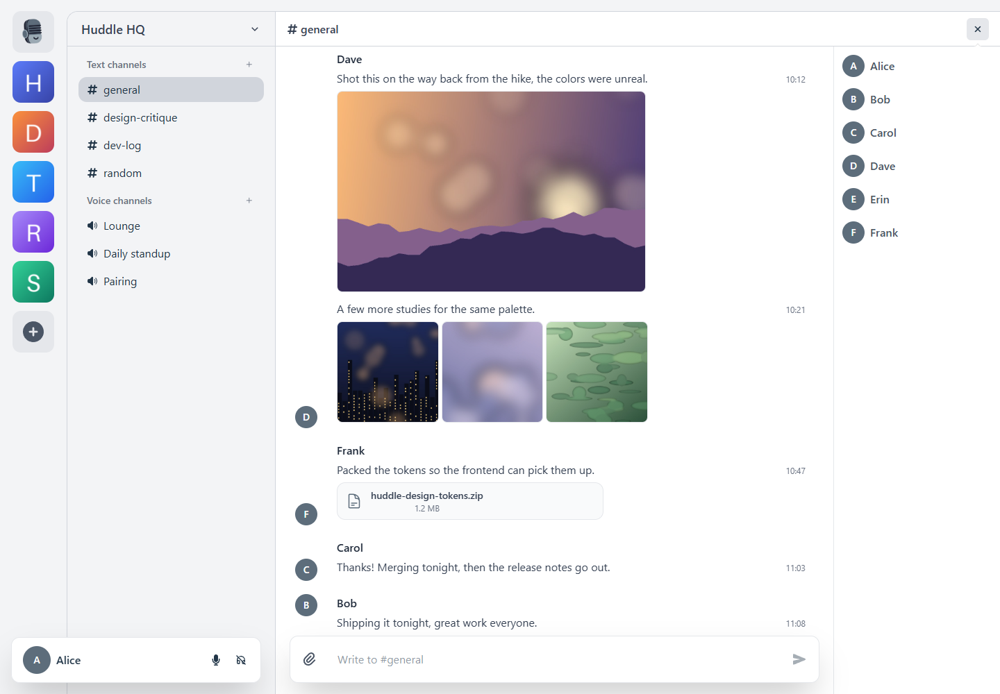

# 🎤 Huddle
[](https://dotnet.microsoft.com/)
[](https://react.dev/)
[](https://learn.microsoft.com/dotnet/aspire/)
[](LICENSE)

**Huddle** is a real-time chat application (a Discord alternative) built on .NET with a service-oriented
architecture, orchestrated locally by **.NET Aspire**. It demonstrates DDD and Clean Architecture, CQRS with a
transactional outbox, event-driven communication over RabbitMQ and a complete real-time stack (SignalR + WebRTC).



## 🚀 Features
- 💬 **Servers and channels**: servers with members, avatar and invite links; text and voice channels.
- 📜 **Text chat**: windowed message list with bidirectional infinite scroll and per-channel scroll position
  restore, message editing and deletion, attachments with drag & drop and previews.
- 🎥 **Voice channels**: WebRTC over a self-hosted **LiveKit** SFU with live participant events in the UI.
- 📎 **File storage**: attachments and avatars in **MinIO** (S3-compatible) through a dedicated file service,
  with size/MIME validation and presigned URLs.
- 🔐 **Authentication**: OpenID Connect (Duende IdentityServer) for the SPA, JWT bearer for every API.
- ⚡ **Real-time**: SignalR hub fed by RabbitMQ integration events published through the outbox.
- 🔍 **Observability**: OpenTelemetry traces, metrics and logs plus the Aspire dashboard out of the box.

## 🏛️ Architecture


The only client is a **React SPA**. Every request goes through the **YARP API Gateway**, which resolves the
services with Aspire service discovery. Services own their data and interact in two ways: synchronously over
HTTP/gRPC when a response is needed on the spot (the channel service claims an upload before attaching it, the
voice service checks channel access over gRPC) and asynchronously over **RabbitMQ integration events** for
everything that can happen in the background.

| Service | Project | Responsibility | State |
|---|---|---|---|
| Identity | `Huddle.Identity` | users and login, OIDC/JWT issuing (Duende IdentityServer + ASP.NET Identity) | `identitydb` |
| Channel | `ChannelService/*` | servers, members, invites, channels, messages; DDD layers, CQRS with MediatR, outbox, gRPC access API | `channeldb` |
| Files | `Huddle.FileService` | attachments and avatars, validation, presigned URLs, object storage | `filedb`, MinIO |
| Voice | `Huddle.Voice.WebApi` | LiveKit access tokens and webhooks, voice participant events | — |
| Realtime | `Huddle.SignalR` | notifications hub that pushes events to connected clients | Redis backplane |
| Gateway | `Gateways/Huddle.ApiGateway` | routing, WebSocket passthrough, service discovery | — |

**How a message travels**

1. The SPA posts to `/channel/api/messages` through the gateway; the channel service writes the message and an
   integration event in the same transaction (outbox) and returns immediately.
2. A background publisher forwards the event to RabbitMQ.
3. The realtime service consumes it and pushes the message to the channel group over SignalR; the voice service
   does the same for participant events.
4. Attachments are uploaded to the files service first; the channel service only accepts file ids it can claim,
   so attachment URLs are resolved on read and no storage address is persisted.

## 🧰 Tech stack

- **Backend**: .NET 9, ASP.NET Core, MediatR (CQRS), EF Core 9 + PostgreSQL, YARP, Duende IdentityServer 7,
  SignalR with a Redis backplane, gRPC, MinIO SDK, LiveKit .NET SDK.
- **Infrastructure** (provisioned by Aspire): PostgreSQL, Redis, RabbitMQ, MinIO, LiveKit, OpenTelemetry,
  service discovery and resilience defaults.
- **Frontend**: React 19 + TypeScript, Vite, Tailwind CSS 4, TanStack Query, Zustand, react-router,
  react-oidc-context, @livekit/components-react.

## 📁 Repository layout

```
src/
  Huddle.AppHost/              Aspire orchestration: containers, configuration, generated secrets
  Gateways/Huddle.ApiGateway/  YARP gateway
  Huddle.Identity/             Duende IdentityServer + ASP.NET Identity
  ChannelService/              Channel WebApi + Domain / Application / Infrastructure / Dtos
  Huddle.FileService/          uploads, validation and MinIO storage
  Huddle.Voice.WebApi/         LiveKit tokens, webhooks and voice events
  Huddle.SignalR/              notifications hub
  EventBus/, EventBusRabbitMQ/, IntegrationEventLogEF/   messaging building blocks
  Shared/                      protobuf contracts and shared helpers
  Huddle.ServiceDefaults/      OpenTelemetry, HTTP resilience, service discovery
  Clients/huddle.react/        React SPA
tests/
  ChannelService.FunctionalTests/
```

## 🛠️ Getting started

Requirements: **.NET 9 SDK**, **Docker Desktop** and **Node.js 20+**.

```powershell
dotnet dev-certs https --trust
cd src/Huddle.AppHost
dotnet run
```

The AppHost starts everything: the SPA dev server, all services, PostgreSQL, Redis, RabbitMQ, MinIO and
LiveKit. The Aspire dashboard URL is printed in the console — services, endpoints, logs and traces are
available there.

## 🔐 Configuration (development)

- **Secrets are generated, not committed.** The LiveKit API key pair and the internal channel → files key are
  created on every AppHost run. Pin them with `LiveKit:ApiKey`, `LiveKit:ApiSecret` or `Files:InternalApiKey`
  when a value has to survive a restart.
- **LiveKit configuration is rendered at startup** and passed as `LIVEKIT_CONFIG`; there is no machine specific
  config file in the repository. The public address advertised to WebRTC clients (`rtc.node_ip`) is detected
  automatically and can be overridden with `LiveKit:NodeIp`. See
  [LiveKitConfigBuilder](src/Huddle.AppHost/LiveKit/LiveKitConfigBuilder.cs).
- **LiveKit ports** must be reachable from clients: `7880/tcp` (signalling, through the gateway), `7881/tcp`
  (ICE over TCP) and `50000-60000/udp`. Behind a router they have to be forwarded to the developer machine.

## 🧪 Tests

```
dotnet test
```

## 📚 Inspiration & References
- https://github.com/dotnet/eShop
- https://github.com/dotnet-architecture/eShopOnContainers/tree/dev
- https://github.com/ardalis/CleanArchitecture
- https://learn.microsoft.com/ru-ru/dotnet/architecture/microservices/

## 📄 License

Huddle is released under the [MIT License](LICENSE).

Licenses of the frameworks, packages and container images it is built on — including the ones that need
attention — are listed in [THIRD-PARTY-NOTICES.md](THIRD-PARTY-NOTICES.md).
