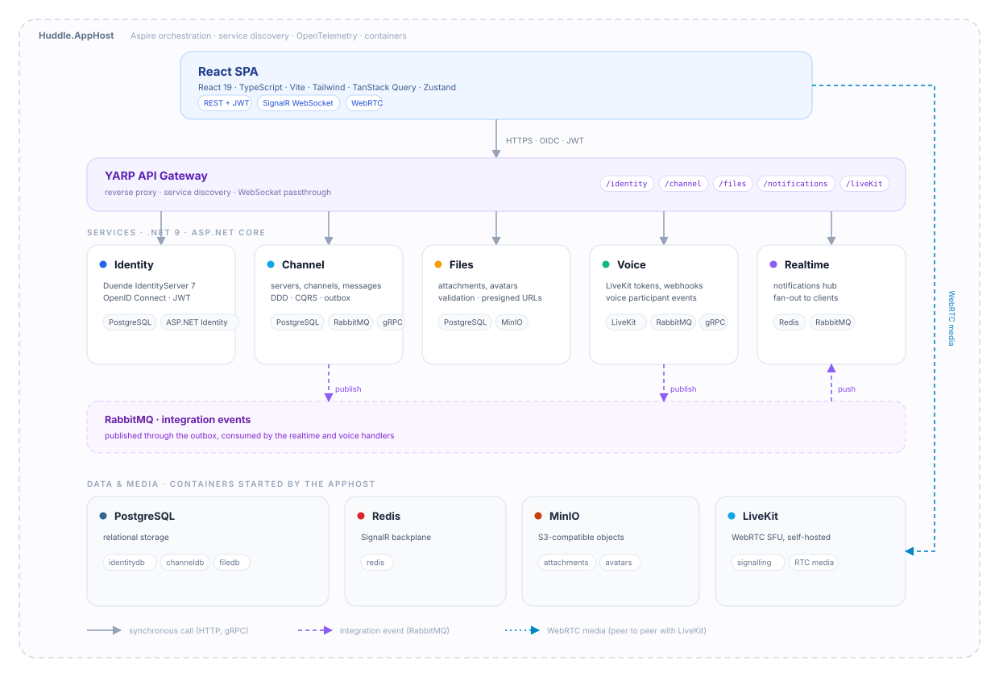

# 🎤 Huddle
[](https://dotnet.microsoft.com/)


**Huddle** is a real-time chat application (a Discord alternative) built on .NET using a service-oriented architecture and **.NET Aspire**. This project demonstrates the practical application of DDD, Clean Architecture, and patterns for building resilient distributed systems.

## 🚀 Features
- 🎥 **WebRTC** for real-time voice and video communication.
- 🏗️ **Clean Architecture + DDD**: strict separation into Domain, Application, Infrastructure, and API layers.
- 📨 **CQRS with MediatR**: clear separation of commands and queries.
- 📦 **Outbox Pattern**: guaranteed event delivery via RabbitMQ.
- 🔍 **Observability**: OpenTelemetry, structured logging (Serilog), and the .NET Aspire dashboard out of the box.
- 📎 **File storage**: chat attachments and server avatars are stored in **MinIO** (S3-compatible) through a dedicated file service.

## 📎 File storage (MinIO)
The AppHost starts a MinIO container and a `filedb` database; every upload goes through **`Huddle.FileService`**, which is exposed through the gateway under `/files/**`.

Endpoints:
- `POST /api/files?kind=attachment` or `?kind=avatar` — multipart upload (`file` field), returns the file id and the relative content URL.
- `GET /api/files/{id}/content` — streams the file; add `?download=true` to force a download.
- `GET /api/files/{id}/url` — short-lived presigned MinIO URL (owner only).
- `DELETE /api/files/{id}` — removes the object and its metadata (owner only).
- `POST /api/files/claim` — internal endpoint the channel service uses to verify uploaded files before they are attached to a message or a server avatar.

Limits and validation: up to 10 files per message, 25 MB per attachment, 5 MB per avatar; `png`, `jpeg`, `gif`, `webp`, `pdf`, `txt`, `csv`, `json`, `zip`, `docx`, `xlsx` (avatars must be images). The channel service stores attachment metadata (`message_attachments`) and the server avatar file id, and resolves the URLs itself, so the storage host is never persisted.


## 🏛️ Architecture



## 🛠️ Getting Started
- Ensure you have the .NET 8 SDK (or later) and Docker Desktop installed.
- Trust the development HTTPS certificates:
```dotnet dev-certs https --trust ```
- Run the AppHost project:
 ```cd src/Huddle.AppHost ```
 ``` dotnet run ```

## 📚 Inspiration & References
- https://github.com/dotnet/eShop
- https://github.com/dotnet-architecture/eShopOnContainers/tree/dev
- https://github.com/ardalis/CleanArchitecture
- https://learn.microsoft.com/ru-ru/dotnet/architecture/microservices/
